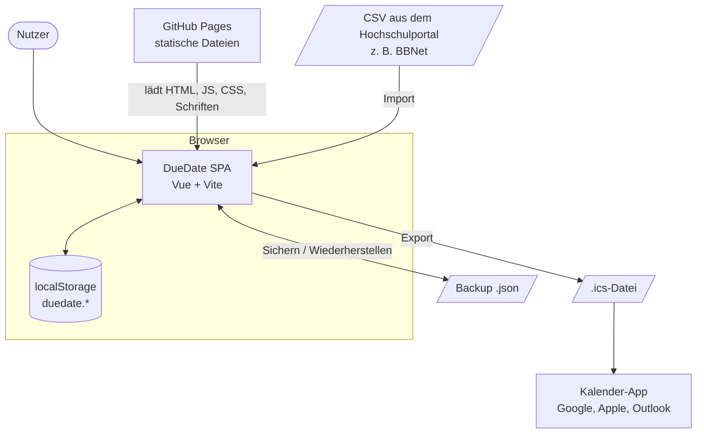
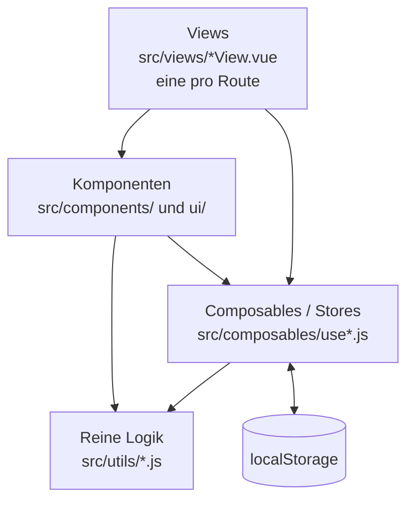
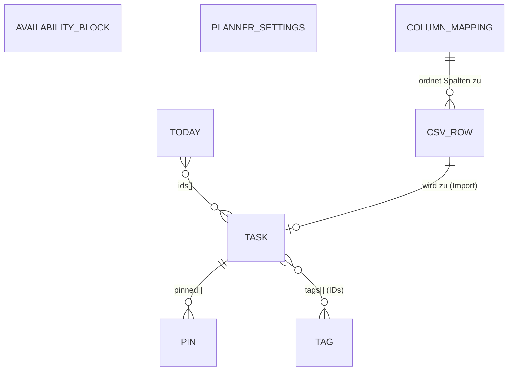
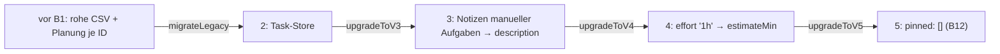
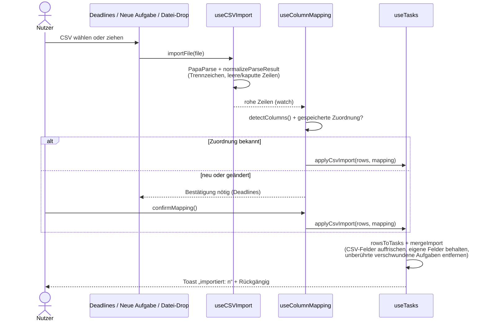
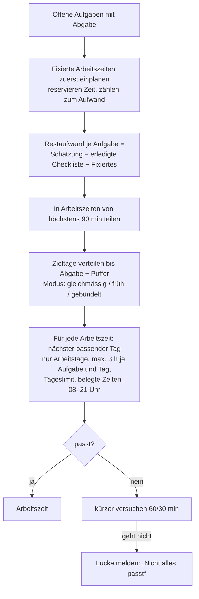
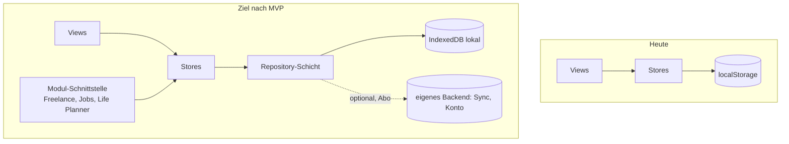
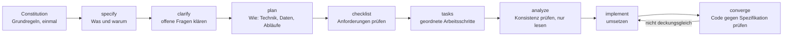

# DueDate — Softwarearchitektur, Roadmap und spec-getriebene Entwicklung

> Stand: **v0.2.4** (November 2026). Erstellt durch Reverse Engineering des Codes auf `main`.
> Zweck: ein Dokument, aus dem Menschen und KI-Agenten verstehen, **wie DueDate gebaut ist**,
> **was geplant ist** und **wie neue Features ab jetzt spezifiziert und umgesetzt werden**.
> Ergänzt `README.md` (Einstieg), `DESIGN.md` (Gestaltung), `ROADMAP.md` (Schritte und Status)
> und `docs/BACKUP_FORMAT.md` (Dateiformat). Bei Widerspruch gilt der Code, dann dieses Dokument.

**Inhalt**
1. [Überblick](#1-überblick)
2. [Tech-Stack, Build und Auslieferung](#2-tech-stack-build-und-auslieferung)
3. [Systemkontext](#3-systemkontext)
4. [Schichten und Regeln](#4-schichten-und-regeln)
5. [Verzeichnisstruktur](#5-verzeichnisstruktur)
6. [Datenmodell und Persistenz](#6-datenmodell-und-persistenz)
7. [Kernabläufe](#7-kernabläufe)
8. [Oberfläche, Gestaltung, Sprache, Barrierefreiheit](#8-oberfläche-gestaltung-sprache-barrierefreiheit)
9. [Qualität: Tests, Prüfungen, CI/CD](#9-qualität-tests-prüfungen-cicd)
10. [Technische Schulden und Risiken](#10-technische-schulden-und-risiken)
11. [Geplante Features und Zielarchitektur](#11-geplante-features-und-zielarchitektur)
12. [Spec-getriebene Entwicklung mit Spec Kit (Anleitung)](#12-spec-getriebene-entwicklung-mit-spec-kit-anleitung)

---

## 1. Überblick

DueDate ist ein **persönliches, lokales Deadline- und Planungswerkzeug** für Studium, Freelance und Privates.
Es läuft vollständig im Browser, ohne Server und ohne Konto. Alle Daten liegen im `localStorage` des Browsers
und lassen sich als JSON sichern.

| Kennzahl (v0.2.4) | Wert |
|---|---|
| Quellcode (`src/`, ohne Tests) | ca. 9 700 Zeilen JavaScript und Vue |
| Seiten (Routen) | 6 (Überblick, Deadlines, Stundenplan, Kalender, Einstellungen, Design-Referenz) |
| Komponenten | 13 Fachkomponenten, 23 UI-Bausteine |
| Composables (Stores und Aktionen) | 25 |
| Reine Logik-Module (`utils/`) | 26 |
| Unit-Tests | 505 (Vitest), Laufzeit unter 2 s |
| Laufzeit-Abhängigkeiten | 10 (Vue, Router, Tailwind, PapaParse, ics, Schriften, Icons) |

**Leitprinzipien, die die Architektur prägen**
- **Local-first:** kein Backend, keine Anmeldung, keine Netzwerkanfragen zur Laufzeit (auch Schriften sind selbst gehostet).
- **Erfassen vor Ordnen:** eine Aufgabe ist in unter 5 Sekunden angelegt (Taste `N`, Schnellsyntax).
- **Gegen Prokrastination:** eine klare nächste Aktion, „3 für heute“, ein Planer, der Arbeit früh verteilt, keine Vorwürfe in Texten.
- **Daten gehören dem Nutzer:** Export als JSON (Backup), ICS (Kalender); jede Datenmodelländerung hat eine Migration.
- **Barrierefrei:** Tastatur, sichtbarer Fokus, WCAG-Kontrast, ARIA. Das ist nicht verhandelbar (siehe `DESIGN.md` §10).

---

## 2. Tech-Stack, Build und Auslieferung

| Bereich | Technologie | Bemerkung |
|---|---|---|
| UI-Framework | **Vue 3.5**, Composition API, `<script setup>` | reines JavaScript, kein TypeScript |
| Build | **Vite 8** | `base: '/duedate/'` für GitHub Pages |
| Styling | **Tailwind CSS 4** über `@tailwindcss/vite` | Design-Tokens als CSS-Variablen `--dd-*`, `@theme inline` |
| Routing | **vue-router 4**, Hash-Modus (`#/…`) | funktioniert auf statischem Hosting ohne Server-Regeln |
| CSV | **PapaParse** | Trennzeichen automatisch erkannt |
| Kalender-Export | **ics** | wird erst beim Export geladen (dynamischer Import) |
| Icons | **Phosphor** (`@phosphor-icons/vue`) | ein Gewicht app-weit (`bold`) |
| Schriften | Geist, Bricolage Grotesque, Space Mono über `@fontsource` | selbst gehostet, keine Google-Fonts-Anfrage |
| Tests | **Vitest 4** (Projekt `unit`, Node-Umgebung) | Storybook-Projekt im Browser ist eingerichtet, aber leer |
| Prüfungen im Browser | Playwright + axe-core | bisher als lokale Skripte, nicht im Repo |
| Hosting | **GitHub Pages** über GitHub Actions | `.github/workflows/deploy.yml` |

**Befehle**

```bash
npm install
npm run dev        # http://localhost:5173/duedate/
npm test           # Unit-Tests
npm run build      # Produktions-Build nach dist/
npm run preview    # Build lokal ansehen
```

**Auslieferung (CD)**


Ein Release (Tag `vX.Y.Z` und Notes) wird von Hand auf GitHub angelegt. Versionsregel: Patch zählt bis `x.y.9`,
Minor nur bei sehr grossen Features. Die Version steht in `package.json`.

---

## 3. Systemkontext



Es gibt **keinen Server-Teil**. GitHub Pages liefert nur statische Dateien. Alles andere geschieht im Browser.

---

## 4. Schichten und Regeln



| Schicht | Aufgabe | Regeln |
|---|---|---|
| **Views** | Eine Seite pro Route; setzen Komponenten zusammen und verbinden sie mit Stores | keine Geschäftslogik, die man testen müsste; Logik gehört nach `utils/` |
| **Komponenten** | Wiederverwendbare Oberfläche; `ui/` sind fachneutrale Bausteine (Button, Dialog, Badge …) | Texte nur über `t('…')`; Farben nur über Tokens; Barrierefreiheit eingebaut |
| **Composables** | **Stores als Modul-Singletons**: der Zustand liegt auf Modulebene, `useX()` gibt dieselben Refs an alle zurück. Jeder Store speichert sich selbst unter `duedate.<name>.v1` | ein Store pro Datenart; Schreiben über Funktionen (`updateTask`, `setStatus` …); Rückmeldung über Toast mit „Rückgängig“ |
| **Utils** | **Reine Funktionen** ohne Vue, ohne `window` (Ausnahme: `downloadIcs`) | alles hier hat Unit-Tests; `now`/`today` wird als Parameter übergeben, damit Tests feste Daten nutzen |

Weitere Konventionen:
- **Codes statt übersetzter Texte vergleichen** (z. B. `_statusCode`, nie das deutsche Label).
- **Abgeleitete Felder** tragen einen Unterstrich (`_days`, `_statusCode`, `_area`, `_checklist`) und werden nie gespeichert.
- **Kommentare und Bezeichner Englisch, Oberflächentexte Deutsch** (Englisch als zweite Sprache).
- **Ein Feature pro Commit** (`feat:`, `fix:`, `refactor:`, `docs:`, `chore:`), Tests und Build nach jedem Schritt.

---

## 5. Verzeichnisstruktur

```text
.
├── index.html, vite.config.js, package.json
├── .github/workflows/deploy.yml   Test, Build und Veröffentlichung auf GitHub Pages
├── .storybook/                    Storybook-Konfiguration (noch ohne Stories)
├── docs/                          ARCHITECTURE.md (dieses Dokument), BACKUP_FORMAT.md
├── test-data/csv/                 Beispiel-CSVs (Semikolon, Komma, fehlerhafte Zeilen)
├── DESIGN.md                      Gestaltungsregeln und Tokens
├── ROADMAP.md                     Schritte, Status, Entscheide
├── PROJECT_CONTEXT.md             Produktvision und frühe Historie
└── src/
    ├── main.js                    App-Start, Schriften, Router, persistenter Speicher anfragen
    ├── App.vue                    Shell: Seitenleiste, Schnellerfassung (N), Aufgaben-Panel, Toasts, Datei-Drop
    ├── style.css                  Tokens hell/dunkel (--dd-*), Tailwind-Theme
    ├── router/index.js            Routen (Hash-Modus)
    ├── views/                     HomeView, DeadlinesView, StundenplanView, CalendarView, SettingsView, DesignView
    ├── components/
    │   ├── AppSidebar, QuickAdd, TaskDetail, WeekGrid, ColumnMappingConfirm, DataSettings,
    │   │   TagMenu, TagPicker, TagFilter, AreaFilter, FileDropOverlay
    │   ├── calendar/              MonthGrid, YearGrid
    │   └── ui/                    BaseButton, BaseDialog, BaseInput, SegmentedControl, DueBadge,
    │                              MarkdownEditor, ProgressBar, EffortInput, DayPicker, AppToaster …
    ├── composables/               Stores und Aktionen (siehe 6.3)
    ├── utils/                     reine Logik mit Tests in utils/__tests__/
    └── locales/                   de.js, en.js (+ Test, dass alle benutzten Schlüssel existieren)
```

---

## 6. Datenmodell und Persistenz

### 6.1 Entitäten



**Task** (`utils/taskModel.js`, Schema 5)

| Feld | Typ | Bedeutung |
|---|---|---|
| `id` | string | CSV: `taskId(title, dueRaw)` (stabil über Re-Importe, auch für ICS-UIDs); manuell: `m-<zeit>-<zufall>` |
| `title` | string | Titel |
| `area` | `'study' \| 'freelance' \| 'personal'` | Bereich (Studium, Freelance, Privat) |
| `status` | `'open' \| 'done'` | erledigt oder nicht |
| `due` / `dueRaw` | `'YYYY-MM-DD'` / Originaltext | Abgabe (normalisiert / wie in der CSV) |
| `start`, `category`, `files`, `graded` | CSV-Felder | nur lesbar bei CSV-Aufgaben |
| `description` | Markdown | Beschreibung; Zeilen `- [ ]` sind die **Checkliste** (C1) |
| `notes` | string | eigene Notizen zu CSV-Aufgaben (deren Beschreibung gehört der CSV) |
| `priority` | `'high' \| 'medium' \| 'low' \| null` | `null` = automatisch (bewertete Arbeiten zählen als hoch) |
| `estimateMin` | number \| null | Gesamtaufwand in Minuten (30-Minuten-Raster) |
| `tags` | string[] | Tag-IDs |
| `pinned` | `{ id, date, startMin, endMin }[]` | vom Nutzer verschobene, fixierte Arbeitszeiten (B12) |
| `steps` | [] | Altlast, ungenutzt |
| `source` / `sourceKey` | `'csv' \| 'manual'` / string | Herkunft; Schlüssel für den Abgleich beim Re-Import |
| `createdAt`, `updatedAt`, `completedAt` | ISO-Zeit | Zeitstempel |

Weitere gespeicherte Objekte: **Tag** `{ id, name, color }`, **Belegte Zeit** `{ id, label, days[], startTime, endTime }`,
**Heute** `{ date, ids[], skipped[] }`, **Planer-Einstellungen** `{ bufferDays, maxPerDayHours, workDays[], mode }`,
**Spaltenzuordnung** `{ role: columnName }`.

**Nicht gespeichert:** der berechnete Plan (`usePlanState`). Er ist eine reine Ableitung und wird bei jeder Änderung neu berechnet.

### 6.2 localStorage-Schlüssel

| Schlüssel | Inhalt | Im Backup |
|---|---|---|
| `duedate.taskStore.v1` | `{ tasks: Task[] }` (**Quelle der Wahrheit**) | ja |
| `duedate.schemaVersion` | aktuelle Schema-Version (5) | ja |
| `duedate.tasks.v1` | letzte rohe CSV `{ fileName, rows }` (für neue Spaltenzuordnung) | ja |
| `duedate.columnMapping.v1` | bestätigte Spaltenzuordnung | ja |
| `duedate.tags.v1` | `{ tags: Tag[] }` | ja |
| `duedate.availability.v1` | belegte Zeiten | ja |
| `duedate.today.v1` | Auswahl „3 für heute“ | ja |
| `duedate.plannerSettings.v1` | Puffer, Tageslimit, Arbeitstage, Modus | ja |
| `duedate.theme.v1`, `duedate.locale.v1` | Hell/Dunkel, Sprache | ja |
| `duedate.areaFilter.v1`, `duedate.tagFilter.v1`, `duedate.calendarView.v1` | Ansichtsvorlieben | nein |
| `duedate.lastBackup.v1`, `duedate.backupHintUntil.v1` | Backup-Erinnerung | nein |
| `duedate.afterReload` | Hinweis nach Wiederherstellen/Löschen (einmalig) | nein |
| `duedate.taskPlanning.v1` | Altlast vor B1, nur von der Migration gelesen | nein |

### 6.3 Stores (Composables)

| Store / Aktion | Verantwortung |
|---|---|
| `useTasks` | Aufgaben laden, migrieren, speichern; `addTask`, `updateTask`, `setStatus`, `removeTask(s)`, `restoreTask(s)`, `applyCsvImport` |
| `useTaskEnrichment` | Aufgaben mit abgeleiteten Feldern, sortiert nach Abgabe |
| `useTaskPlanning` | Aufwand und Priorität je Aufgabe (Fassade für Views und Planer) |
| `useTaskActions` | Erledigen mit Toast und Rückgängig, überall gleich |
| `useTaskDetail` | welches Aufgaben-Panel offen ist, inkl. Kontext (Arbeitszeit, von der man kam) |
| `useCSVImport`, `useColumnMapping`, `useFileImport` | CSV lesen, Spalten erkennen und bestätigen, Import aus jedem Einstieg |
| `useTags`, `useTagFilter`, `useAreaFilter` | Tags und Filter |
| `useAvailability` | belegte Zeiten |
| `usePlannerSettings`, `usePlanState`, `usePlanEdit` | Planer-Regeln, berechneter Plan (folgt den Daten), Verschieben/Fixieren |
| `useToday` | „3 für heute“ |
| `useBackup` | Export, Wiederherstellen, alles löschen, Erinnerung |
| `useICSExport`, `usePlanExport`, `useCombinedExport` | Kalenderdateien |
| `useToast`, `useQuickAdd`, `useTheme`, `useLocale`, `usePageEyebrow` | Shell, Rückmeldung, Sprache, Darstellung |

### 6.4 Schema-Versionen und Migrationen



- Beim Start liest `useTasks` die Version und wendet alle fehlenden Schritte an (idempotent, rein, getestet).
- **Backups älterer Schemata** werden beim Import mit derselben Kette hochgezogen (`utils/backup.js`).
- Regel für jede künftige Änderung: neue Version, `upgradeToVn`, Test, Backup-Import, `docs/BACKUP_FORMAT.md`.

---

## 7. Kernabläufe

### 7.1 CSV-Import



### 7.2 Schnellerfassung

`N` (oder Seitenleiste) öffnet `QuickAdd`. `utils/quickAddParser.js` zerlegt die Eingabe:
Datum (`heute`, `morgen`, `fr`, `15.12.`, `24. April` …), Bereich (`#studium`, `#freelance`, `#privat`),
Priorität (`!`), Tags (jedes andere `#wort`). Der Rest ist der Titel. Vorschau live, `Enter` speichert,
`Shift+Enter` speichert und bleibt offen. Im selben Dialog kann eine Datei importiert werden.

### 7.3 Planer (Herzstück)

`utils/scheduler.js → generatePlan(tasks, getPlanningFor, blocks, now, options)` ist **deterministisch**
(gleiche Eingabe, gleicher Plan), lokal und ohne KI.



- Reihenfolge: dringendste zuerst, dann Priorität, dann Titel. Überfällige Aufgaben so früh wie möglich.
- Horizont 26 Wochen. Ergebnis: `{ days, sessions[], shortfalls[], horizonEnd }`, Arbeitszeiten mit `n/of`.
- `usePlanState` berechnet neu, sobald sich Aufgaben, belegte Zeiten oder Regeln ändern (rollender Plan).
- `usePlanEdit` verschiebt eine Arbeitszeit per Ziehen (`WeekGrid`, 15-Minuten-Raster) oder im Panel; sie wird als `pinned` an der Aufgabe gespeichert. `utils/slotCheck.js` lehnt Vergangenheit und Zeiten ausserhalb 08–21 Uhr ab und warnt bei Konflikten.

### 7.4 „3 für heute“

`utils/todaySuggestion.js` sortiert offene Aufgaben nach Dringlichkeits-Stufe, Priorität, Tagen bis zur Abgabe
und schlägt bis zu drei vor. Der Nutzer wählt am Morgen; jeder neue Tag beginnt leer. Der Überblick zeigt
die nächste Aktion (erster offener Checklisten-Schritt) und den Tagesfortschritt.

### 7.5 Kalender und Export

- `CalendarView` mit Tag, Woche (`WeekGrid`), Monat (`MonthGrid`) und Jahr (`YearGrid`), Farben nach Bereich, Tastatur-Navigation.
- `utils/ics.js` erzeugt Ereignisse mit **stabilen UIDs** (aus Aufgaben-ID, bei Arbeitszeiten plus Nummer). Erneutes Importieren in eine Kalender-App aktualisiert statt zu verdoppeln.

### 7.6 Backup

`utils/backup.js`: `createBackup` → Datei `{ format, version, schema, exportedAt, app, data }`, `parseBackup` prüft
Format und Version, `applyBackup` schreibt alles und migriert alte Schemata, danach lädt die Seite neu
(jeder Store liest seine Daten nur beim Start). Format: `docs/BACKUP_FORMAT.md`.

---

## 8. Oberfläche, Gestaltung, Sprache, Barrierefreiheit

**Routen**

| Route | View | Inhalt |
|---|---|---|
| `#/` | HomeView | Überblick: „3 für heute“, nächste Aktion, Tagesfortschritt, Backup-Hinweis |
| `#/deadlines` | DeadlinesView | Tabelle aller Aufgaben, CSV-Import, Spaltenzuordnung, Filter |
| `#/stundenplan` | StundenplanView | Aufwand je Aufgabe, belegte Zeiten, Planungsregeln, Plan der Woche |
| `#/calendar` | CalendarView | Tag/Woche/Monat/Jahr, Neu planen, Export (alt: `#/my-week`) |
| `#/settings` | SettingsView | Sprache, Darstellung, Daten und Backup, Aufräumen |
| `#/design` | DesignView | Referenz der Tokens und Bausteine (nicht in der Seitenleiste) |

In der Seitenleiste ausgegraut (noch nicht gebaut): Projekte, Freelance, Jobs, Life Planner.

**App-Shell** (`App.vue`): Seitenleiste, globale Taste `N`, Datei-Drop auf das ganze Fenster, Aufgaben-Panel
(natives `<dialog>` rechts), Toasts mit einer Aktion („Rückgängig“).

**Gestaltung** (`DESIGN.md`): Tokens `--dd-*` in `src/style.css`, Dunkel als Standard, Hell über die Klasse
`.light` auf `<html>` (warmer, gedämpfter Hintergrund). Bereichsfarben: Studium blau, Freelance grün, Privat gelb.
Schriften: Bricolage Grotesque (Titel), Geist (Text), Space Mono (Zahlen).

**Sprache**: `locales/de.js` und `en.js`, `useLocale().t(key, params)`. Ein Test stellt sicher, dass jeder
im Code benutzte Schlüssel in beiden Sprachen existiert.

**Barrierefreiheit**: echte Buttons und Labels, `aria-*` an Rastern und Dialogen, eine Tab-Station je Raster
mit Pfeiltasten, sichtbarer Fokus, Kontrast nach WCAG AA (geprüft mit axe), Ziehen hat immer eine Tastatur-Alternative.

---

## 9. Qualität: Tests, Prüfungen, CI/CD

| Ebene | Stand |
|---|---|
| Unit-Tests | 505 Tests in `src/**/__tests__/*.test.js` für die reine Logik (Planer, Parser, Import, Migrationen, Backup, Kalender …) |
| Sprachschlüssel | Test prüft alle `t('…')`-Schlüssel in `de` und `en` |
| Browser | Playwright-Skripte und axe-core bisher **ad hoc** bei der Entwicklung, nicht im Repo |
| Komponenten | Storybook eingerichtet, aber ohne Stories |
| CD | Merge auf `main` → Tests, Build, GitHub Pages |
| CI auf Pull Requests | **fehlt noch** (siehe 10) |

---

## 10. Technische Schulden und Risiken

| Thema | Risiko | Vorschlag |
|---|---|---|
| Keine Prüfung auf Pull Requests | Kaputtes erreicht `main`, bevor die Tests laufen; wichtig bei mehreren Agenten | Workflow `ci.yml` auf `pull_request` + Pflicht-Prüfung für `main` |
| `localStorage` | etwa 5 MB, synchron, kein Schutz bei zwei offenen Tabs (der letzte Schreibvorgang gewinnt, es gibt keinen `storage`-Listener) | Tabs synchronisieren oder warnen; später IndexedDB (z. B. Dexie) hinter den Stores |
| Browser-Tests nicht im Repo | Abläufe (Ziehen, Dialoge) nur manuell geprüft | Playwright-Tests mit axe als eigenes Vitest-/Playwright-Projekt |
| Storybook ungenutzt | Ballast in Abhängigkeiten und Konfiguration | Stories für `ui/` schreiben oder entfernen |
| Altlasten im Modell | `steps`, `duedate.taskPlanning.v1`, `/my-week` | bei der nächsten Migration aufräumen |
| Gemischte Sprache in alten Dateien | `columnDetector.js`, `useColumnMapping.js` mit deutschen Kommentaren | beim nächsten Anfassen vereinheitlichen |
| `PROJECT_CONTEXT.md` | ältere Phasennamen (A–G) widersprechen `ROADMAP.md` | als Historie kennzeichnen oder angleichen |
| Datenmodell ist auf eine Hochschul-CSV zugeschnitten | Spaltenerkennung kennt typische Spalten | bleibt, aber Auswahl beim Import (B14) |

---

## 11. Geplante Features und Zielarchitektur

Quelle: `ROADMAP.md`. Status: ✅ fertig, ⬜ offen.

### 11.1 MVP (Definition des Nutzers)

Der MVP ist erreicht, wenn diese Features **perfekt** funktionieren (alle Zustände gestaltet, Tastatur und axe sauber,
Tests grün, Deutsch und Englisch vollständig):

| # | Feature | Stand | Fehlt |
|---|---|---|---|
| 1 | Schnellerfassung und Überblick | ✅ | Überblick als Quickview überarbeiten |
| 2 | Deadlines und CSV-Import | ✅ | **B14** Auswahl beim Import |
| 3 | Planer und Kalender | ✅ (B8–B13) | Politur |
| 4 | Kleinkram (Quicktasks) | ⬜ | **K3** |
| 5 | Daten und Backup | ✅ | Einstieg für neue Nutzer |
| + | Kanban mit Projekten | ⬜ | **K1, K2** |

Danach: Veröffentlichung als Open Source mit eigener Webseite; später Desktop/Mobile; die übrigen Module zuerst
privat, später als Abo. Offen vor der Veröffentlichung: Lizenz bestätigen (README nennt MIT, eine `LICENSE`-Datei fehlt), Ort des Codes für Bezahl-Module, Namensprüfung.

### 11.2 Geplante Schritte

| Phase | Schritte (Kurzform) |
|---|---|
| **B14** | CSV-Import mit Vorschau und Auswahl; alte Zeilen vorab abgewählt; abgewählte Einträge werden gemerkt (Ignorierliste) |
| **K — Kanban, Projekte, Kleinkram** | K1 Board (Status „In Arbeit“, „Review“) · K2 Projekte (Ordner mit Fortschritt, Projekt-Board) · K3 Kleinkram-Liste · K4 Hauptboard mit errechnetem Projektstatus · K5 Vorlagen, Checkliste → Aufgaben · K6 Spalten steuern den Kalender |
| **C — Gegen Prokrastination** | C2 Fokus-Timer · C2b Schätzung lernt aus erfasster Zeit · C3 Wiedervorlage · C4 wiederkehrende Aufgaben · C5 Wochenrückblick · C6 Erinnerungen über den Kalender |
| **D — Freelance** | D1 Kunden · D2 Projekte (baut auf K2 auf) · D3 Zeiterfassung · D4 Kalkulation · D5 Offerte als PDF · D6 Offerten-Status |
| **E — Mobile** | responsives Layout, Touch-Ziehen |
| **F — Persönlich/Job** | F1 Bewerbungs-Tracker · F2 Monatsexport · F3 Habit-Tracker (Wochenziele, Serien) |
| **Später** | Überblick als Quickview, Kalender-Sync (Feed über eigenes Backend), eigenes Backend und Sync, Module ein/aus, KI erst nach allem anderen |

### 11.3 Was sich an der Architektur ändern wird

| Feature | Datenmodell | Neue Bausteine (Vorschlag) |
|---|---|---|
| B14 | Ignorierliste je `sourceKey` (Schema 6), Backup erweitern | `ImportPreview.vue`, `mergeImport` überspringt Ignoriertes |
| K1 | `status: 'open' \| 'doing' \| 'review' \| 'done'` | `BoardView`, Board-Komponenten, Ziehen mit Tastatur-Alternative |
| K2 | neuer Store `duedate.projects.v1` `{ id, name, area, due, paused }`, `task.projectId` | `useProjects`, `utils/projectProgress.js`, Projekt-Seiten |
| K3 | `task.quick: true` (keine Planung, kein Board) | Kleinkram-Liste auf dem Überblick, Umwandeln |
| K4–K6 | keins oder Planer-Option „nur Spalten X“ | errechneter Projektstatus, Planer-Filter |
| C2/D3 | Zeiteinträge (eigener Store, später IndexedDB) | `useFocusTimer`, `useTimeEntries` |
| F3 | `duedate.habits.v1` | Habit-Komponenten |
| Backend/Sync | Stores bekommen eine Sync-Schicht dahinter; Austauschformat = Backup-JSON | eigenes Backend erst nach Phase E |



Grundsatz bleibt: **lokal zuerst**. Ein Backend kommt als optionale Sync-Schicht hinter die Stores, nicht an ihre Stelle.

---

## 12. Spec-getriebene Entwicklung mit Spec Kit (Anleitung)

> Grundlage: [github/spec-kit](https://github.com/github/spec-kit), Stand der Doku November 2026
> (CHANGELOG 1.4.0 vom 10.11.2026, Lizenz MIT). Spec Kit ändert sich schnell. Bei Abweichungen gilt
> die offizielle Doku; was hier als „prüfen“ markiert ist, war in der Doku nicht eindeutig.

### 12.1 Die Idee in einem Satz

Zuerst wird **aufgeschrieben, was und warum** (Spezifikation), dann **wie** (Plan), dann **in welchen Schritten**
(Aufgaben). Erst danach wird programmiert. Die Spezifikation ist der Vertrag zwischen dir und jedem Agenten
(Claude Code, GitHub Copilot …). So arbeiten mehrere Agenten am selben Ziel, ohne dass jeder die Absicht neu errät.



### 12.2 Einmalig einrichten

**Voraussetzungen:** Python 3.11+, [uv](https://docs.astral.sh/uv/) (empfohlen), Git, Claude Code.
Windows wird ohne WSL unterstützt; dort nutzt Spec Kit standardmässig PowerShell-Skripte.

1. **uv installieren** (falls nicht vorhanden, laut uv-Doku). Windows PowerShell:
   ```powershell
   powershell -ExecutionPolicy ByPass -c "irm https://astral.sh/uv/install.ps1 | iex"
   ```
   macOS/Linux:
   ```bash
   curl -LsSf https://astral.sh/uv/install.sh | sh
   ```
2. **Spec Kit installieren und prüfen:**
   ```bash
   uv tool install specify-cli
   ```
   ```bash
   specify version
   ```
   Wer nichts dauerhaft installieren will, nutzt die Einmal-Variante:
   ```bash
   uvx --from git+https://github.com/github/spec-kit.git specify init --here --integration claude
   ```
3. **Im DueDate-Repo auf einem eigenen Branch einrichten** (Spec Kit fügt Dateien hinzu und kann
   verwaltete Pfade ersetzen, deshalb vorher alles committen):
   ```bash
   git switch -c chore/spec-kit
   ```
   ```bash
   specify init --here --force --integration claude
   ```
   - `--here` = aktueller Ordner, `--force` ist nötig, weil der Ordner nicht leer ist.
   - Es entstehen `.specify/` (Vorlagen, Skripte, Projektgedächtnis) und Claude-Skills unter
     `.claude/skills/speckit-<befehl>/SKILL.md`. Ausserdem schreibt die Integration eine `.claude/settings.json`
     (Ereignisse; abschaltbar mit `--integration-options="--events false"`). **Diff ansehen**, dann committen.
   - **Zweiter Agent (GitHub Copilot)** im selben Repo:
     ```bash
     specify integration install copilot
     ```
4. **Spec Kit ändert nichts am App-Code** und leitet keine Spezifikationen aus dem bestehenden Code ab.
   Dieses Dokument ist deshalb die Ausgangslage („Brownfield“): Agenten sollen es vor jeder Spezifikation lesen.

### 12.3 Die Befehle (in Claude Code)

In Claude Code heissen die Befehle mit Bindestrich (`/speckit-specify`); die Doku schreibt sie teils mit Punkt
(`/speckit.specify`). Copilot nutzt ebenfalls `/speckit-…`. Sie laufen im Chat des Agenten, nicht im Terminal.

| Reihenfolge | Befehl | Wofür | Wann |
|---|---|---|---|
| 1 | `/speckit-constitution` | Grundregeln des Projekts festhalten | **einmal**, danach selten anpassen |
| 2 | `/speckit-specify <Beschreibung>` | Spezifikation: Nutzen, Abläufe, Akzeptanzkriterien, **ohne Technik** | je Feature |
| 3 | `/speckit-clarify` | offene Fragen klären, Antworten in die Spezifikation | je Feature, empfohlen |
| 4 | `/speckit-plan <Technik-Hinweise>` | technischer Plan: Datenmodell, Migration, Komponenten, Tests | je Feature |
| 5 | `/speckit-checklist` | Qualitätscheck der Anforderungen (vollständig, eindeutig, testbar) | optional |
| 6 | `/speckit-tasks` | geordnete Arbeitsschritte (`tasks.md`) | je Feature |
| 7 | `/speckit-analyze` | prüft Spezifikation, Plan und Aufgaben auf Widersprüche, ändert nichts | vor dem Umsetzen |
| 8 | `/speckit-implement` | setzt die Aufgaben um | nach deiner Freigabe |
| 9 | `/speckit-converge` | vergleicht Code und Spezifikation, ergänzt fehlende Aufgaben; wiederholen bis „Converged“ | nach dem Umsetzen |

Kurzweg für kleine Features: constitution (einmal) → specify → plan → tasks → implement → converge.
Für Fehler gibt es eine Erweiterung (`specify extension add bug`, Befehle `/speckit-bug-assess`, `-fix`, `-test`).

**Dateien je Feature:** sicher sind `spec.md`, `plan.md`, `tasks.md` und `checklists/requirements.md`; das aktive Feature
steht in `.specify/feature.json`. Der genaue Ordner (bisher üblich `specs/NNN-name/`, dazu ggf. `research.md`,
`data-model.md`, `contracts/`, `quickstart.md`) und der Ort der Constitution (bisher `.specify/memory/constitution.md`)
**nach dem Init im Repo prüfen**. Nummerierte Branches (`001-name`) legt Spec Kit nur mit der Git-Erweiterung an
(`specify extension add git`).

### 12.4 Vorschlag für die DueDate-Constitution

Beim ersten `/speckit-constitution` diese Punkte vorgeben (aus `ROADMAP.md`, `DESIGN.md` und dieser Datei abgeleitet,
bewusst ohne persönliche Angaben, weil das Repo öffentlich werden soll):

```text
/speckit-constitution Erstelle die Grundregeln für DueDate aus README.md, DESIGN.md, ROADMAP.md und docs/ARCHITECTURE.md:
1. Local-first: keine Server-Abhängigkeit zur Laufzeit, keine Anfragen an Dritte, Daten bleiben im Browser.
2. Daten gehören dem Nutzer: jede Datenmodelländerung bekommt eine Schema-Version, eine idempotente Migration
   (upgradeToVn), Tests und eine Anpassung von Backup-Import und docs/BACKUP_FORMAT.md. Nie Daten verlieren.
3. Schichten: reine Logik in src/utils mit Unit-Tests; Stores als Modul-Singletons in src/composables;
   Views ohne Geschäftslogik.
4. Barrierefreiheit ist nicht verhandelbar: Tastatur, sichtbarer Fokus, WCAG AA, ARIA; Ziehen hat immer eine
   Tastatur-Alternative; axe ohne Verstösse.
5. Texte nur über die Sprachdateien (de und en vollständig); Code und Kommentare Englisch; nie gegen übersetzte
   Texte vergleichen.
6. Gestaltung nach DESIGN.md (Tokens, Dunkel/Hell, Bereichsfarben); unterstützende Sprache, keine Vorwürfe.
7. Gegen Prokrastination: eine klare nächste Aktion, wenig Reibung, Erfassen in unter 5 Sekunden.
8. Keine neue Abhängigkeit ohne Begründung im Plan.
9. Kleine Schritte: ein Feature pro Pull Request, Tests und Build grün, Roadmap-Status aktualisiert.
10. KI-Funktionen erst, wenn alles ohne KI funktioniert; immer mit Rückfall ohne KI.
```

### 12.5 Ablauf für ein Feature (Beispiel B14)

1. **Branch:** `git switch -c feat/b14-csv-import-auswahl` (oder Git-Erweiterung).
2. **Spezifizieren** (Was und warum, aus Nutzersicht):
   ```text
   /speckit-specify Beim CSV-Import will ich vor dem Übernehmen sehen, welche Zeilen neu sind, und einzelne abwählen.
   Zeilen mit einer Abgabe, die länger als 30 Tage zurückliegt, sind vorab abgewählt, weil Dozierende alte Einträge
   oft nicht löschen. Abgewählte Einträge sollen beim nächsten Import derselben Datei nicht wiederkommen und in den
   Einstellungen zurückgeholt werden können. Gilt für den Import auf der Deadlines-Seite und für die Abkürzung in
   "Neue Aufgabe". Details: ROADMAP.md, Abschnitt B14.
   ```
3. **Klären:** `/speckit-clarify`. Antworte auf die Fragen; die Antworten landen in der Spezifikation.
   **Hier ist dein erster Halt:** Spezifikation lesen, erst dann weiter (entspricht unserem „Weiter“).
4. **Planen** (Wie, mit unserer Technik):
   ```text
   /speckit-plan Vue 3 + Vite, reines JavaScript. Halte dich an docs/ARCHITECTURE.md. Ignorierliste je sourceKey
   als Schema 6 mit upgradeToV6, Backup-Format erweitern. Logik rein in src/utils mit Unit-Tests (mergeImport,
   Vorauswahl nach Alter). Neue Komponente ImportPreview.vue mit Tastaturbedienung und Texten in de/en.
   ```
5. **Aufgaben:** `/speckit-tasks`, danach `/speckit-analyze`. **Zweiter Halt:** Aufgabenliste ansehen.
6. **Umsetzen:** `/speckit-implement`, danach `/speckit-converge` bis „Converged“.
7. **Abschluss:** `npm test` und `npm run build` grün, Browser-Prüfung mit Tastatur und axe, `ROADMAP.md` aktualisieren,
   Pull Request, Merge (dann veröffentlicht GitHub Actions automatisch).

### 12.6 Regeln, die bei uns gelten

| Thema | Regel |
|---|---|
| Wofür Spec Kit? | Für **Features** aus der Roadmap (B14, K1–K6, C2–C6 …). Kleine Korrekturen (Text, Farbe, Tippfehler) ohne Spezifikation; Fehler mit der Bug-Erweiterung. |
| Roadmap ↔ Spezifikation | Ein Roadmap-Schritt = eine Spezifikation. Die Roadmap bleibt die Übersicht und verlinkt auf die Spezifikation. |
| Spezifikationen im Git | **Ja, committen** und als Historie behalten (Spec Kit nennt das „flow-forward“: jedes Feature behält seinen Ordner, neue Anforderungen bekommen einen neuen). Spec Kit schreibt kein Modell vor, das ist unsere Teamregel. |
| Privates | Persönliche Angaben gehören nie in Spezifikation oder Constitution. Die private `CLAUDE.md` bleibt ausserhalb von Git. |
| Mehrere Agenten | Die Spezifikation ist der Auftrag. Pro Feature arbeitet **ein** Agent auf **einem** Branch; Aufgaben aus `tasks.md` können als GitHub-Issues an Copilot gehen, wenn sie unabhängig sind. Zwei Agenten nie an denselben Dateien. |
| Freigaben | Du gibst nach `clarify` (Spezifikation) und nach `tasks` (Aufgaben) frei. `implement` erst danach. |
| Qualitätsschranke | Vor dem Merge: Tests, Build, axe, Spezifikation erfüllt (`converge`). Empfohlen: Workflow `ci.yml` auf Pull Requests als Pflicht-Prüfung (siehe Abschnitt 10). |

### 12.7 Häufige Fehler

- **Technik in die Spezifikation schreiben.** `specify` beschreibt Nutzen und Verhalten; Technik gehört in `plan`.
- **Zu grosse Features.** Lieber K1 und K2 getrennt als „Kanban komplett“.
- **Freigaben überspringen.** Gerade bei Agenten ist der Halt nach der Spezifikation der billigste Moment für Korrekturen.
- **Spezifikation und Code laufen auseinander.** Nach Änderungen `converge` laufen lassen oder die Spezifikation nachführen.
- **Spec Kit ohne Pinning in Teams.** Mit `uvx … spec-kit.git` ohne Version läuft immer der aktuelle Stand von `main`. Für reproduzierbare Ergebnisse eine Version festlegen (`…spec-kit.git@vX.Y.Z`).
